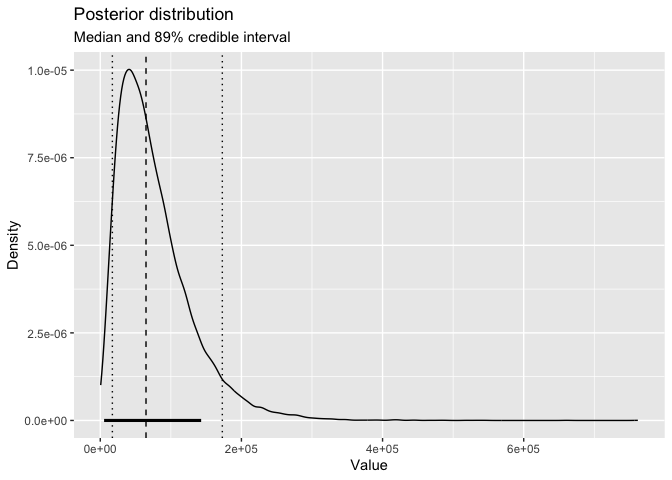

<!-- README.md is generated from README.Rmd. Please edit that file -->

# bayesfermi 

<!-- badges: start -->

<!-- badges: end -->

This R package helps you make probabilistic estimates using the [Fermi
method](https://en.wikipedia.org/wiki/Fermi_problem). It allows you to
break down complex problems into smaller, manageable variables and
calculate the probability distribution of the outcome using Monte Carlo
simulations.

Whether you’re estimating market size, the potential impacts of a policy
change, or the number of piano tuners in Chicago, this tool provides a
rigorous yet accessible way to handle uncertainty.

## Installation

You can install the development version of bayesfermi from
[GitHub](https://github.com/) with:

``` r
# install.packages("pak")
pak::pak("matthewgthomas/bayesfermi")
```

## Example

Let’s say you want to estimate the annual number of dwelling fires in
England. You can decompose this problem as follows:

$$
\text{number of dwelling fires} = \text{number of dwellings} \times \text{rate of dwelling fires}
$$

where `number of dwellings` can be further decomposed into:

$$
\text{number of dwellings} = \text{population} \times \text{average household size}
$$

You would then express your beliefs about each component using
probability distributions (priors), and use the `bayesfermi` package to
simulate the overall distribution of dwelling fires:

``` r
library(bayesfermi)

# ---- Priors ----
# Population of England, which we'll judge to be between 54 and 56 million with 80% credibility
england_pop_prior <- expert_gamma_prior(
  q = c(5.4e7, 5.6e7),
  p = c(0.1, 0.9)
)

# Average number of people in a household, judged to be between 2 and 3.2 with 80% credibility
hh_size_prior <- expert_normal_prior(
  mean = 2.4,
  lower = 2.0,
  upper = 3.2,
  level = 0.8
)

# Risk of dwelling fires, judged to be between 0.01% and 0.06%, with 80% credibility
fire_rate_prior <- expert_beta_prior(
  q = c(0.001, 0.006),
  p = c(0.1, 0.9)
)

# ---- Fermi simulation ----
fermi_res <- bf_fermi_simulate(
  components = list(
    pop = england_pop_prior,
    hh_size = hh_size_prior,
    p_fire = fire_rate_prior
  ),
  # This is where we define how the components combine to give the final estimate
  fun = function(pop, hh_size, p_fire) {
    (pop / hh_size) * p_fire
  },
  n_draws = 20000
)

# Summarise and plot
posterior_summary(fermi_res, cred_level = 0.89)
#> Posterior summary
#>   Credible level: 89 %
#>   Median        : 64805.06 
#>   CI            : [17136.3, 172936.4]
#>   HDI           : [5433.46, 142942.3]

plot_posterior(fermi_res, cred_level = 0.89)
```


