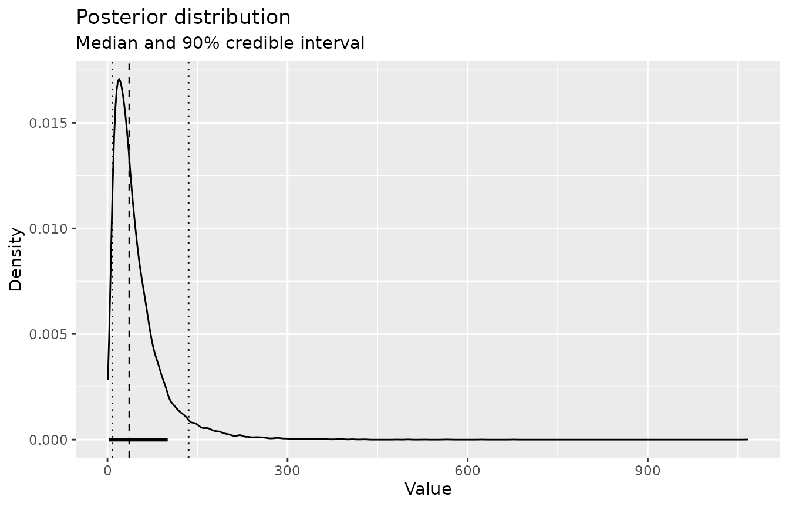

# Bayesian Fermi Estimation with \`fermi\`: The Chicago Piano Tuners Example

## Introduction

The `fermi` package supports Bayesian Fermi estimation: breaking down
uncertain quantities into components (decomposition), expressing beliefs
as probability distributions (priors), and building uncertainty into the
final estimates.

This vignette demonstrates the classic [Fermi
problem](https://en.wikipedia.org/wiki/Fermi_problem): \> How many piano
tuners are in Chicago?

We will:

- Decompose the problem.
- Construct expert-driven priors.
- Run a Bayesian Fermi simulation.
- Summarise and visualise the resulting distribution.

``` r
library(fermi)
```

## How many piano tuners are in Chicago?

If you didn’t have access to data, how would you estimate the number of
piano tuners in Chicago? A Fermi estimate breaks the problem into
smaller components that can be estimated more easily. We then combine
these estimates to get a final answer.

A Bayesian version of this approach encodes uncertainty about each
component as a probability distribution (a prior). We then use Monte
Carlo simulation to propagate this uncertainty through the calculation,
resulting in a probability distribution for the final estimate.

First, we need to decompose the problem by breaking it down into smaller
parts.

The decomposition we will use is:

$$\text{tuners} = \frac{\text{population}}{\text{people per household}} \times \text{fraction of households with a piano} \times \text{tunings per piano per year}\;/\;\left( \text{working days per year} \times \text{tunings per tuner per day} \right).$$

## Prior beliefs from expert judgement

### Population of Chicago

**Belief:** 80% probability between 2.5M and 3.5M.

We’ll encode this belief as a gamma prior using the
[`expert_gamma_prior()`](https://humaniverse.github.io/fermi/reference/expert_gamma_prior.md)
function. We are using a gamma distribution here because the population
is a positive count.

``` r
population_prior <- expert_gamma_prior(
  q = c(2.5e6, 3.5e6),
  p = c(0.1, 0.9)
)
#> Warning in expert_gamma_prior(q = c(2500000, 3500000), p = c(0.1, 0.9)):
#> expert_gamma_prior: quantile match may be imprecise. Squared error on q:
#> 2.39e+08 (method = normal, shape ~= 59.1)
population_prior
#> fermi prior
#>   Distribution: gamma 
#>   Source      : expert 
#>   Parameters  :
#> $shape
#> [1] 59.12548
#> 
#> $rate
#> [1] 1.970849e-05
```

Let’s check
[`expert_gamma_prior()`](https://humaniverse.github.io/fermi/reference/expert_gamma_prior.md)
has captured our beliefs correctly:

``` r
stats::qgamma(
  c(0.1, 0.9),
  shape = population_prior$params$shape,
  rate = population_prior$params$rate
)
#> [1] 2512119 3509602
```

### Household size

**Belief:** Mean ≈ 2.7; 80% probability between 2.2 and 3.2.

We’ll encode this belief as a normal prior using the
[`expert_normal_prior()`](https://humaniverse.github.io/fermi/reference/expert_normal_prior.md)
function. We are using a normal distribution here because household size
can be reasonably approximated as a continuous variable.

``` r
hh_size_prior <- expert_normal_prior(
  mean = 2.7,
  lower = 2.2,
  upper = 3.2,
  level = 0.8
)

hh_size_prior
#> fermi prior
#>   Distribution: normal 
#>   Source      : expert 
#>   Parameters  :
#> $mean
#> [1] 2.7
#> 
#> $sd
#> [1] 0.3901521
```

### Fraction of households with a piano

**Belief:** 80% probability between 2% and 8%.

We’ll encode this belief as a beta prior using the
[`expert_beta_prior()`](https://humaniverse.github.io/fermi/reference/expert_beta_prior.md)
function. We are using a beta distribution here because the fraction is
a probability between 0 and 1.

``` r
piano_frac_prior <- expert_beta_prior(
  q = c(0.02, 0.08),
  p = c(0.1, 0.9)
)

piano_frac_prior
#> fermi prior
#>   Distribution: beta 
#>   Source      : expert 
#>   Parameters  :
#> $shape1
#> [1] 3.623535
#> 
#> $shape2
#> [1] 72.7708
```

Let’s check
[`expert_beta_prior()`](https://humaniverse.github.io/fermi/reference/expert_beta_prior.md)
has captured our beliefs correctly:

``` r
stats::qbeta(
  c(0.1, 0.9),
  shape1 = piano_frac_prior$params$shape1,
  shape2 = piano_frac_prior$params$shape2
)
#> [1] 0.02000001 0.07999992
```

### Tunings per piano per year

**Belief:** Most pianos tuned every 1–3 years ⇒ 0.3–1.0 tunings/year.

We’ll encode this belief as a gamma prior using the
[`expert_gamma_prior()`](https://humaniverse.github.io/fermi/reference/expert_gamma_prior.md)
function. Again, we use a gamma distribution because the number of
tunings is a positive count.

``` r
tunes_per_piano_prior <- expert_gamma_prior(
  q = c(0.3, 1.0),
  p = c(0.1, 0.9)
)

tunes_per_piano_prior
#> fermi prior
#>   Distribution: gamma 
#>   Source      : expert 
#>   Parameters  :
#> $shape
#> [1] 4.890221
#> 
#> $rate
#> [1] 7.851207
```

### Working days per year

**Belief:** Mean ≈ 230; 90% probability between 180 and 280.

We’ll encode this belief as a normal prior using the
[`expert_normal_prior()`](https://humaniverse.github.io/fermi/reference/expert_normal_prior.md)
function. We are using a normal distribution here because the number of
working days can be reasonably approximated as a continuous variable.

``` r
work_days_prior <- expert_normal_prior(
  mean = 230,
  lower = 180,
  upper = 280,
  level = 0.9
)

work_days_prior
#> fermi prior
#>   Distribution: normal 
#>   Source      : expert 
#>   Parameters  :
#> $mean
#> [1] 230
#> 
#> $sd
#> [1] 30.39784
```

### Tunings per tuner per day

**Belief:** 80% probability of between 2 and 5 tunings per tuner per
day.

We’ll encode this belief as a gamma prior using the
[`expert_gamma_prior()`](https://humaniverse.github.io/fermi/reference/expert_gamma_prior.md)
function. Again, we use a gamma distribution because the number of
tunings is a positive count.

``` r
tunes_day_prior <- expert_gamma_prior(
  q = c(2, 5),
  p = c(0.1, 0.9)
)

tunes_day_prior
#> fermi prior
#>   Distribution: gamma 
#>   Source      : expert 
#>   Parameters  :
#> $shape
#> [1] 8.187309
#> 
#> $rate
#> [1] 2.40024
```

## Simulate the number of piano tuners (with uncertainty)

With our priors in place, we can now simulate over all components. The
function passed to
[`bf_fermi_simulate()`](https://humaniverse.github.io/fermi/reference/bf_fermi_simulate.md)
mirrors the decomposition above.

``` r
tuner_draws <- bf_fermi_simulate(
  components = list(
    pop = population_prior,
    hh_size = hh_size_prior,
    piano_frac = piano_frac_prior,
    tunes_per_piano = tunes_per_piano_prior,
    work_days = work_days_prior,
    tunes_day = tunes_day_prior
  ),
  fun = function(
    population,
    hh_size,
    piano_frac,
    tunes_per_piano,
    work_days,
    tunes_day
  ) {
    (population / hh_size) *
      piano_frac *
      tunes_per_piano /
      (work_days * tunes_day)
  },
  n_draws = 20000
)
```

### Summarise the result

We’ll summarise the results of the simulation (the posterior
distribution) using
[`posterior_summary()`](https://humaniverse.github.io/fermi/reference/posterior_summary.md).

``` r
tuner_summary <- posterior_summary(tuner_draws, cred_level = 0.89)
tuner_summary
#> Posterior summary
#>   Credible level: 89 %
#>   Median        : 36.31656 
#>   CI            : [8.606157, 129.9963]
#>   HDI           : [1.717152, 96.42675]
```

Based on our beliefs, and our uncertainty about them, we estimate there
are around 36 piano tuners in Chicago, with a 89% credible interval from
about 9 to 130.

## Visualise the result

Finally, take a quick look at the posterior distribution. The dashed
line marks the median; dotted lines are the 90% credible interval.

``` r
plot_posterior(tuner_draws, cred_level = 0.9)
```



## Conclusion

This vignette showed how to:

- Decompose a Fermi problem,
- Construct expert-driven Bayesian priors,
- Simulate the resulting distribution using
  [`bf_fermi_simulate()`](https://humaniverse.github.io/fermi/reference/bf_fermi_simulate.md),
- Summarise and plot the implied number of piano tuners.

The same workflow applies to any Bayesian Fermi estimation task: break
the problem into factors, elicit priors, and let simulation propagate
the uncertainty.

This package also lets you fit priors to actual data, using
[`fit_beta_prior()`](https://humaniverse.github.io/fermi/reference/fit_beta_prior.md),
[`fit_gamma_prior()`](https://humaniverse.github.io/fermi/reference/fit_gamma_prior.md)
and
[`fit_normal_prior()`](https://humaniverse.github.io/fermi/reference/fit_normal_prior.md).
You can also update priors (e.g. based on expert beliefs) with data
using conjugate Bayesian updating functions like
[`beta_binom_posterior()`](https://humaniverse.github.io/fermi/reference/beta_binom_posterior.md)
and
[`gamma_poisson_posterior()`](https://humaniverse.github.io/fermi/reference/gamma_poisson_posterior.md).
See the package documentation for more details.
