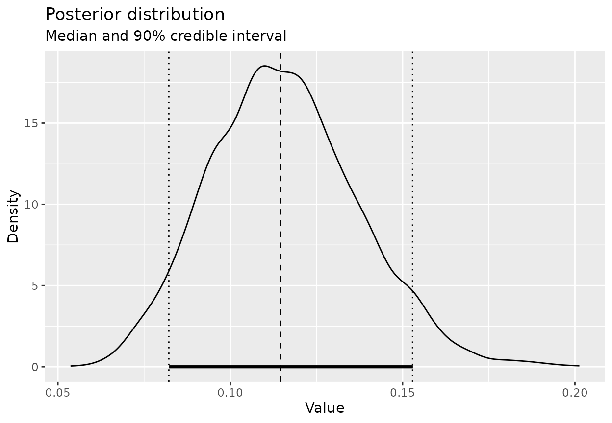
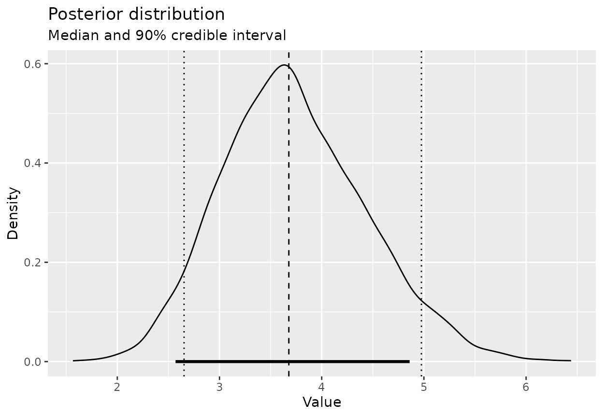
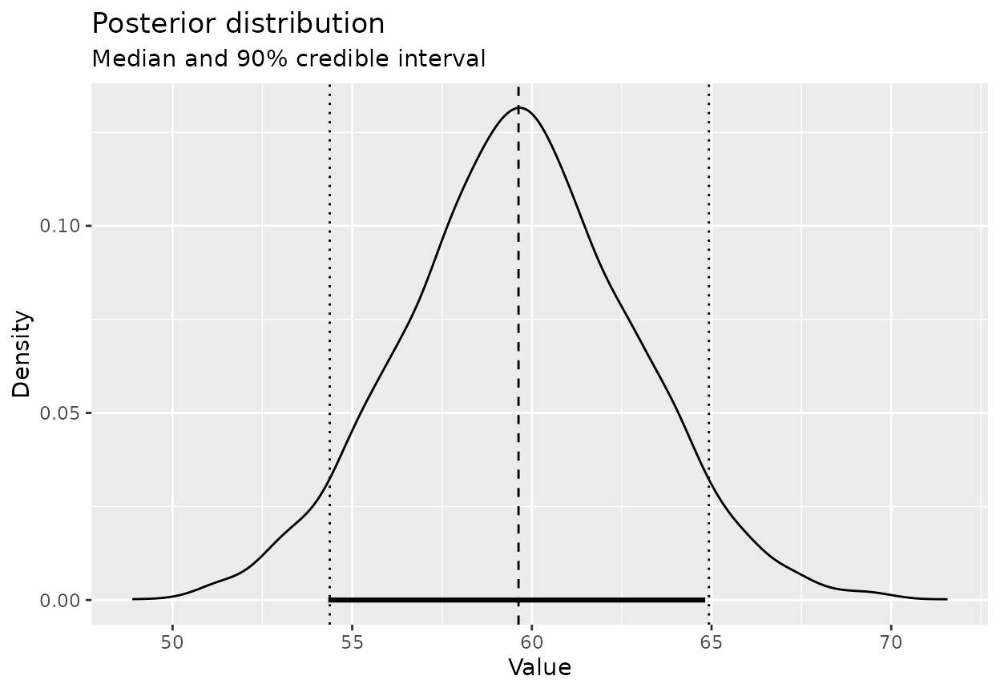

# Conjugate updates with \`fermi\`: Beta–Binomial, Gamma–Poisson, and Normal–Normal

``` r
library(fermi)
```

## Introduction

The `fermi` package is built around two ideas:

1.  **Fermi decompositions** of hard problems into simpler parts.
2.  **Bayesian updating** of beliefs as data arrive.

This vignette focuses on the second part: conjugate updates using:

- beta_binom_posterior() – updating beliefs about a probability.
- gamma_poisson_posterior() – updating beliefs about a rate of counts.
- normal_normal_posterior() – updating beliefs about a mean with known
  noise.

Each section below explains:

- When to use the updating functions and why.
- How to express your prior with fermi and update it with data.

Each example picks a realistic question, encodes a prior based on rough
beliefs, updates with data, and inspects the posterior with
[`posterior_summary()`](https://humaniverse.github.io/fermi/reference/posterior_summary.md)
and
[`plot_posterior()`](https://humaniverse.github.io/fermi/reference/plot_posterior.md).

## 1. beta_binom_posterior(): learning a proportion

### 1.1 When and why

Use the **Beta–Binomial** model when:

- The unknown quantity is a **probability** (e.g. proportion of users
  who click a button).
- Your data are **counts of successes** out of a **number of trials**.
- Trials can be treated as independent with the same underlying
  probability.

Mathematically:

**Prior:**  
$$p \sim {Beta}(\alpha,\beta)$$

**Data:**  
$$y \mid p \sim {Binomial}(n,p)$$

**Posterior:**  
$$p \mid y \sim {Beta}(\alpha + y,\;\beta + n - y)$$

The posterior has the same functional form as the prior. That’s what
“conjugate” means here.

### 1.2 Example: Email signup rate on a website

Imagine a website with a “join newsletter” box.

We want to estimate the **signup rate** $$p$$ (the probability that a
visitor signs up), and we want to combine:

- Prior belief (based on other, similar sites).
- Fresh data from the current site.

#### 1.2.1 Prior: expert Beta distribution

Suppose you believe there’s an 80% chance that the signup rate is
between 5% and 20%.

We can encode this as a Beta prior using
[`expert_beta_prior()`](https://humaniverse.github.io/fermi/reference/expert_beta_prior.md):

``` r
signup_prior <- expert_beta_prior(
  q = c(0.05, 0.20), # quantiles
  p = c(0.1, 0.9) # probabilities
)

signup_prior
#> fermi prior
#>   Distribution: beta 
#>   Source      : expert 
#>   Parameters  :
#> $shape1
#> [1] 3.394814
#> 
#> $shape2
#> [1] 25.12697

stats::qbeta(
  c(0.1, 0.9),
  shape1 = signup_prior$params$shape1,
  shape2 = signup_prior$params$shape2
)
#> [1] 0.05000003 0.19999994
```

#### 1.2.2 Data: observed signups

Now we run a short campaign and see:

- 200 visitors
- 23 signups

``` r
visitors <- 200
signups <- 23
```

#### 1.2.3 Posterior: updated Beta using beta_binom_posterior()

``` r
signup_post <- beta_binom_posterior(
  prior = signup_prior,
  successes = signups,
  trials = visitors
)

signup_post
#> fermi posterior
#>   Distribution: beta 
#>   Parameters  :
#> $shape1
#> [1] 26.39481
#> 
#> $shape2
#> [1] 202.127
#> 
#>   Derived from prior (expert)
```

We can summarise the posterior:

``` r
posterior_summary(signup_post, cred_level = 0.9)
#> Posterior summary
#>   Credible level: 90 %
#>   Median        : 0.1142519 
#>   CI            : [0.08241409, 0.152479]
#>   HDI           : [0.08090875, 0.1500094]
```

And visualise it:

``` r
plot_posterior(signup_post, cred_level = 0.9)
```



Interpretation:

- The posterior median is your updated “best guess” for the signup rate.
- The credible interval quantifies uncertainty after seeing data **and**
  incorporating the prior.
- If you observe more data, the posterior will become more concentrated.

## 2. beta_gamma_posterior(): learning a rate of counts

### 2.1 When and why

Use the **Gamma–Poisson** model when:

- The unknown quantity is a **rate** $\lambda$ of events per unit
  exposure (per day, per month, per person-year, etc.).
- Data are **counts** of events, often with an associated exposure
  (e.g. days observed, people at risk).

Mathematically:

- Prior: $\lambda \sim {Gamma}(\alpha,\beta)$
- Data:
  $y_{i} \mid \lambda \sim {Poisson}\left( \lambda \cdot e_{i} \right)$,
  where $e_{i}$ is the exposure for observation $i$.
- Posterior:
  $\lambda \mid y \sim {Gamma}\left( \alpha + \sum y_{i},\;\beta + \sum e_{i} \right)$

This is useful whenever you’re counting random events over time or
space.

### 2.2 Example: Support tickets per day

Suppose you help manage a support team and want to understand the
**average number of tickets per day**, $\lambda$.

You have some prior belief based on experience, and then you collect
data from the first week on a new system.

#### 2.2.1 Prior: Gamma for the ticket rate

Say you believe there’s an 80% chance that there are between 1 and 5
tickets per day.

``` r
tickets_prior <- expert_gamma_prior(
  q = c(1, 5),
  p = c(0.1, 0.9)
)

tickets_prior
#> fermi prior
#>   Distribution: gamma 
#>   Source      : expert 
#>   Parameters  :
#> $shape
#> [1] 2.886175
#> 
#> $rate
#> [1] 1.032756

stats::qgamma(
  c(0.1, 0.9),
  shape = tickets_prior$params$shape,
  rate = tickets_prior$params$rate
)
#> [1] 1 5
```

#### 2.2.2 Data: a week of counts

During the first 7 days, you observe the following counts of support
tickets:

``` r
tickets_week <- c(3, 4, 2, 6, 5, 4, 3)
tickets_week
#> [1] 3 4 2 6 5 4 3
```

Assume each day represents one unit of exposure. We could also pass a
vector of exposures if days were of different length or reliability.

#### 2.2.3 Posterior: updated Gamma using `gamma_poisson_posterior()`

``` r
tickets_post <- gamma_poisson_posterior(
  prior = tickets_prior,
  y = tickets_week,
  exposure = rep(1, length(tickets_week))
)

tickets_post
#> fermi posterior
#>   Distribution: gamma 
#>   Parameters  :
#> $shape
#> [1] 29.88618
#> 
#> $rate
#> [1] 8.032756
#> 
#>   Derived from prior (expert)
```

Summarise the rate (tickets per day):

``` r
posterior_summary(tickets_post, cred_level = 0.9)
#> Posterior summary
#>   Credible level: 90 %
#>   Median        : 3.674416 
#>   CI            : [2.63361, 4.926418]
#>   HDI           : [2.521482, 4.790498]
```

We can also look at the implied distribution of **tickets per day**
directly:

``` r
plot_posterior(tickets_post, cred_level = 0.9)
```



If you want to see the distribution of the **expected tickets over a
month** (say 30 days), just transform the draws:

``` r
lambda_draws <- bf_draws(tickets_post, n = 4000)
tickets_month <- lambda_draws * 30

posterior_summary(tickets_month, cred_level = 0.89)
#> Posterior summary
#>   Credible level: 89 %
#>   Median        : 110.7253 
#>   CI            : [82.10701, 145.8198]
#>   HDI           : [82.08899, 145.8115]
plot_posterior(tickets_month, cred_level = 0.89)
```


Interpretation:

- The Gamma–Poisson update smoothly blends your prior expectation with
  observed counts.
- As you accumulate more days of data, the posterior for the rate
  narrows.

## 3. `normal_normal_posterior()`: learning a mean with known noise

### 3.1 When and why

Use the Normal–Normal model when:

- You care about an unknown mean $\mu$.
- Individual observations are Normally distributed around that mean with
  a known standard deviation $\sigma$.

Mathematically:

- Prior: $\mu \sim {Normal}\left( \mu_{0},\tau_{0}^{2} \right)$
- Data: $y_{i} \mid \mu \sim {Normal}\left( \mu,\sigma^{2} \right)$ with
  a known $\sigma$.
- Posterior:
  $\mu \mid y \sim {Normal}\left( \mu_{n},\tau_{n}^{2} \right)$.

This is natural when measurement noise is well-understood,
e.g. measurement devices with known precision or settings where
variability is stable and well-estimated from past studies.

### 3.2 Example: Average response time

Suppose you’re tracking the average response time (in minutes) to a
certain type of request.

From historical systems you think:

- The average response time is around 60 minutes.
- 90% of your prior belief is between 40 and 80 minutes.

You also believe that, for individual requests, the time is noisy with a
standard deviation of about 15 minutes (due to variation in complexity,
staff availability, etc.).

#### 3.2.1 Prior: Normal for the mean response time

``` r
response_prior <- expert_normal_prior(
  mean = 60,
  lower = 40,
  upper = 80,
  level = 0.9
)

response_prior
#> fermi prior
#>   Distribution: normal 
#>   Source      : expert 
#>   Parameters  :
#> $mean
#> [1] 60
#> 
#> $sd
#> [1] 12.15914
```

#### 3.2.2 Data: observed response times

You collect response times for 20 requests (in minutes):

``` r
# Known observation standard deviation
obs_sd <- 15

response_times <- round(stats::rnorm(20, mean = 55, sd = obs_sd))
response_times
#>  [1] 68 68 81 82 79 52 57 67 48 50 39 40 46 81 51 45 39 37 86 77
```

#### 3.2.3 Posterior: updated Normal using normal_normal_posterior()

``` r
response_post <- normal_normal_posterior(
  prior = response_prior,
  y = response_times,
  obs_sd = obs_sd
)

response_post
#> fermi posterior
#>   Distribution: normal 
#>   Parameters  :
#> $mean
#> [1] 59.67475
#> 
#> $sd
#> [1] 3.233339
#> 
#>   Derived from prior (expert)
```

Summarise the posterior mean:

``` r
posterior_summary(response_post, cred_level = 0.9)
#> Posterior summary
#>   Credible level: 90 %
#>   Median        : 59.73669 
#>   CI            : [54.51551, 65.14882]
#>   HDI           : [54.64528, 65.23133]
```

Visualise the posterior distribution for the mean response time:

``` r
plot_posterior(response_post, cred_level = 0.9)
```



Interpretation:

- The posterior mean moves from the prior mean (60 minutes) towards the
  sample mean.
- How far it moves depends on:
  - The prior uncertainty (how wide the prior is).
  - The number of observations and their variability.
- With more data, the posterior becomes increasingly dominated by the
  data.

## 4. Putting it into a Fermi-style context

The conjugate update functions in `fermi` are designed to play nicely
with how you’d approach Fermi estimation based on prior knowledge and
observed data. Conjugate helpers give you fast, transparent updates:
write down a defensible prior, add evidence, and immediately see the
revised belief. Swap in your own priors and data to fit your domain.

A common workflow looks like this:

- Use
  [`beta_binom_posterior()`](https://humaniverse.github.io/fermi/reference/beta_binom_posterior.md),
  [`gamma_poisson_posterior()`](https://humaniverse.github.io/fermi/reference/gamma_poisson_posterior.md),
  or
  [`normal_normal_posterior()`](https://humaniverse.github.io/fermi/reference/normal_normal_posterior.md)
  to update beliefs about individual components (probabilities, rates,
  or means).
- Treat the resulting `bf_posterior` objects as components in a
  Fermi-style decomposition with
  [`bf_fermi_simulate()`](https://humaniverse.github.io/fermi/reference/bf_fermi_simulate.md).
- Use
  [`posterior_summary()`](https://humaniverse.github.io/fermi/reference/posterior_summary.md)
  and
  [`plot_posterior()`](https://humaniverse.github.io/fermi/reference/plot_posterior.md)
  on the combined result to understand uncertainty about a more complex
  quantity.

In this way, conjugate updates give you a **data-informed starting
point** for Fermi estimations, while the Fermi simulation lets you
combine multiple uncertain components into a final quantity of interest.

## Summary

- [`beta_binom_posterior()`](https://humaniverse.github.io/fermi/reference/beta_binom_posterior.md)
  for learning a probability (e.g. signup rate) from counts of
  successes.
- [`gamma_poisson_posterior()`](https://humaniverse.github.io/fermi/reference/gamma_poisson_posterior.md)
  for learning a rate (e.g. tickets per day) from counts over exposures.
- [`normal_normal_posterior()`](https://humaniverse.github.io/fermi/reference/normal_normal_posterior.md)
  for learning a mean (e.g. average response time) when noise is
  approximately Normal with known standard deviation.

Each function takes a `bf_prior` and returns a `bf_posterior`, which can
be:

- summarised with
  [`posterior_summary()`](https://humaniverse.github.io/fermi/reference/posterior_summary.md),
- visualised with
  [`plot_posterior()`](https://humaniverse.github.io/fermi/reference/plot_posterior.md),
- or used as inputs to further Fermi-style simulations.

These are small, composable building blocks for Bayesian reasoning about
real-world quantities.
